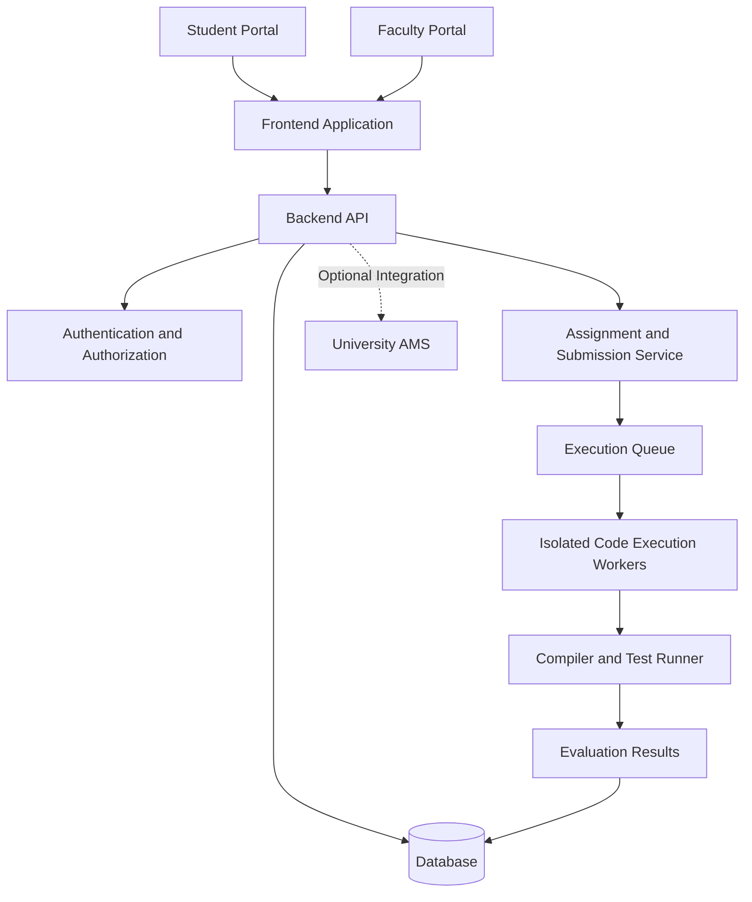
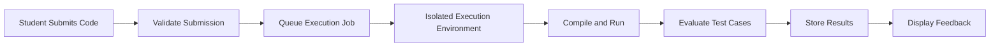

<div align="center">

# 🧪 LabNEXUS

### A Unified Digital Platform for University Coding Labs

**Code. Submit. Evaluate. Improve.**

A centralized coding lab management platform designed to simplify programming assignments, streamline submissions, and support efficient academic evaluation.

<br/>


<br/>

[Features](#-key-features) •
[Architecture](#-system-architecture) •
[Tech Stack](#-technology-stack) •
[Getting Started](#-getting-started) •
[Roadmap](#-roadmap)

</div>

---

## 📌 Table of Contents

- [About the Project](#-about-the-project)
- [Problem Statement](#-problem-statement)
- [Our Solution](#-our-solution)
- [Key Features](#-key-features)
- [User Roles](#-user-roles)
- [System Architecture](#-system-architecture)
- [Technology Stack](#-technology-stack)
- [Project Structure](#-project-structure)
- [Getting Started](#-getting-started)
- [How It Works](#-how-it-works)
- [Security and Reliability](#-security-and-reliability)
- [Roadmap](#-roadmap)
- [Future Scope](#-future-scope)
- [Contributing](#-contributing)
- [Team](#-team)
- [License](#-license)

---

## 📖 About the Project

**LabNEXUS** is a proposed university-focused coding lab management platform that aims to bring programming laboratory activities into a single digital environment.

In many academic environments, theory courses have digital learning and assessment facilities, while programming laboratory submissions may still rely on manual file uploads, disconnected tools, or end-of-semester submission processes.

LabNEXUS aims to bridge this gap by connecting students and faculty through a unified workflow for laboratory assignments, code submissions, evaluation, and progress tracking.

The platform is designed to complement an existing university Academic Management System (AMS), subject to available integration support.

### 🎯 Project Vision

To make university programming laboratories more organized, accessible, transparent, and efficient through digital workflows and automated evaluation.

---

## 🚨 Problem Statement

Traditional programming laboratory workflows can introduce several challenges:

- **Fragmented submissions:** Lab assignments and source code may be distributed across different platforms.
- **Manual evaluation:** Faculty may need to compile, execute, and evaluate submissions individually.
- **Limited progress visibility:** Students may lack a centralized view of deadlines and submission status.
- **Administrative overhead:** Faculty must track submissions, marks, and student progress manually.
- **Academic integrity concerns:** Identifying similar code submissions can be difficult without appropriate tools.
- **Disconnected systems:** Lab activities may not integrate with existing academic portals.

These challenges create an opportunity for a centralized and extensible coding laboratory platform.

---

## 💡 Our Solution

LabNEXUS proposes a structured workflow connecting students, faculty, assignments, submissions, and evaluation.

The platform aims to provide:

- A unified dashboard for laboratory activities.
- Centralized assignment and deadline management.
- Timestamped code submissions and submission history.
- Faculty tools for reviewing submissions and monitoring progress.
- Automated code execution and grading through a secure execution service.
- Performance analytics and evaluation feedback.
- Potential integration with the university's existing AMS.

The implementation of individual capabilities will depend on the project's development stage and available infrastructure.

---

## ✨ Key Features

### 👨‍🎓 Student Portal

- **Student Dashboard:** View enrolled lab courses and relevant activities.
- **Assignment Management:** Access programming tasks, descriptions, and deadlines.
- **Code Submission:** Submit source code through the platform.
- **Submission History:** Review previous submissions and timestamps.
- **Resubmission Support:** Submit updated solutions within permitted deadlines.
- **Evaluation Results:** View marks, execution results, and faculty feedback when available.
- **Deadline Tracking:** Keep track of upcoming and completed assignments.

### 👩‍🏫 Faculty Portal

- **Course Management:** Organize programming laboratory courses.
- **Assignment Creation:** Create and publish programming tasks.
- **Deadline Configuration:** Define submission deadlines and applicable late policies.
- **Test Case Management:** Configure input/output test cases for automated evaluation.
- **Submission Monitoring:** Review student submissions and their status.
- **Progress Tracking:** Monitor submission completion across a class.
- **Grade Management:** Record manual or automated evaluation results.
- **Analytics and Reports:** Generate insights into student performance and submission patterns.

### ⚙️ Coding and Evaluation

- Browser-based code editor with syntax highlighting.
- Multi-language programming support.
- Secure compilation and execution of submitted code.
- Automated evaluation using predefined test cases.
- Execution time and memory limits.
- Code similarity analysis to support academic integrity.

> **Implementation note:** Browser-based editing, multi-language execution, automatic grading, and plagiarism detection require their respective components and must be verified before being described as available features.

### 🔐 Platform and Integration

- Role-based access for students and faculty.
- Secure authentication and session management.
- Course-specific access control.
- Integration with university AMS through supported APIs or learning standards.
- Optional single sign-on using institutional credentials.
- Synchronization of course enrollment and grades where supported.

---

## 👥 User Roles

| Capability | Student | Faculty |
|---|:---:|:---:|
| View enrolled lab courses | ✓ | ✓ |
| View assignments and deadlines | ✓ | ✓ |
| Submit programming solutions | ✓ | — |
| View submission history | ✓ | ✓ |
| Create and publish assignments | — | ✓ |
| Configure evaluation test cases | — | ✓ |
| Review submissions | — | ✓ |
| Manage grades and feedback | View | Manage |
| Monitor class progress | — | ✓ |

Access to individual capabilities will be governed by role-based permissions.

---

## 🏗️ System Architecture

LabNEXUS is intended to use a modular architecture that separates the user interface, application logic, data storage, and code execution environment.

### High-Level Architecture



### Code Execution Workflow



The execution architecture is a proposed design. Submitted code must run in an isolated environment rather than directly on the main application server.

---

## 🛠️ Technology Stack

The final stack should match the technologies actually selected and implemented by the development team.

### Proposed Technology Options

| Layer | Candidate Technologies | Purpose |
|---|---|---|
| Frontend | React.js / Next.js | Responsive user interface |
| Backend | Node.js + Express.js / Django | APIs and business logic |
| Database | PostgreSQL | Users, courses, assignments, and submissions |
| Code Execution | Docker | Isolated program execution |
| Job Queue | Redis / RabbitMQ | Asynchronous execution jobs |
| File Storage | MinIO / AWS S3 | Source files and submission artifacts |
| Authentication | JWT and institutional SSO | Identity and access management |
| Web Server | Nginx | Reverse proxy and request routing |
| Version Control | Git and GitHub | Source code management |

**Important:** These are candidate technologies from the proposed architecture, not a declaration of the project's current implementation. Update this section once the actual stack is finalized.

---

## 📂 Project Structure

The following is an illustrative structure for a modular full-stack implementation. Adapt it to match the actual repository.

```text
LabNEXUS/
│
├── frontend/
│   ├── public/
│   ├── src/
│   │   ├── components/
│   │   ├── pages/
│   │   ├── services/
│   │   ├── hooks/
│   │   └── assets/
│   └── package.json
│
├── backend/
│   ├── src/
│   │   ├── controllers/
│   │   ├── routes/
│   │   ├── services/
│   │   ├── middleware/
│   │   ├── models/
│   │   └── config/
│   └── package.json
│
├── execution-service/
│   ├── workers/
│   ├── runners/
│   └── Dockerfile
│
├── docs/
│   ├── architecture.md
│   └── api.md
│
├── .env.example
├── .gitignore
└── README.md
```

This structure is a suggested organization, not a representation of existing files.

---

## 🚀 Getting Started

### Prerequisites

Before running the project, install the tools required by your selected stack.

Depending on the implementation, these may include:

- Git
- Node.js and npm, if using a JavaScript-based stack
- Python, if using a Python-based backend
- PostgreSQL or the selected database
- Docker, if using isolated code execution

### 1. Clone the Repository

```bash
git clone https://github.com/YOUR_USERNAME/LabNEXUS.git
```

Replace `YOUR_USERNAME` and `LabNEXUS` with the actual GitHub username and repository name.

### 2. Navigate to the Project

```bash
cd LabNEXUS
```

### 3. Install Dependencies

Run the package installation command for the selected frontend and backend.

For a Node.js application:

```bash
npm install
```

Run this command only in a directory containing the appropriate `package.json`.

### 4. Configure Environment Variables

Create a local `.env` file using the project's environment template.

Example variables:

```env
PORT=5000
DATABASE_URL=
JWT_SECRET=
FRONTEND_URL=http://localhost:3000
```

These are illustrative placeholders. Use the variable names required by the actual implementation.

**Never commit real credentials, API keys, tokens, or production secrets to GitHub.**

### 5. Start the Application

Use the scripts defined in the relevant `package.json` files or the run instructions for the selected framework.

Example for a Node.js application:

```bash
npm run dev
```

The actual startup commands, database migrations, and required services must be documented once the project setup is finalized.

---

## 🔄 How It Works

The intended workflow connects the main activities of a university coding lab.

1. **Authentication:** A student or faculty member accesses the platform with the appropriate permissions.
2. **Course Access:** Students view their enrolled laboratory courses.
3. **Assignment Publication:** Faculty publish programming tasks and deadlines.
4. **Code Submission:** Students submit their solutions before the deadline.
5. **Evaluation:** Submissions are reviewed manually or processed through an automated evaluation pipeline.
6. **Feedback:** Results, marks, and relevant feedback are made available to students.
7. **Progress Monitoring:** Faculty review class-level submission status and performance.

---

## 🔒 Security and Reliability

Security is especially important when a platform executes user-submitted programs.

The proposed design includes the following considerations:

- **Authentication and authorization:** Restrict protected actions according to user roles.
- **Input validation:** Validate submissions, uploaded files, and API requests.
- **Execution isolation:** Execute untrusted code in isolated, resource-limited environments.
- **Resource controls:** Apply CPU, memory, execution-time, and output-size limits.
- **Access control:** Prevent users from accessing unauthorized courses, submissions, or grades.
- **Secret management:** Keep credentials and sensitive configuration outside version control.
- **Data protection:** Protect student information and academic records.
- **Auditability:** Maintain appropriate records of submissions and grading operations.

These are design requirements and should not be interpreted as evidence that security controls have already been implemented or independently tested.

---

## 🗺️ Roadmap

The roadmap below describes potential development milestones.

- [ ] Finalize functional and non-functional requirements.
- [ ] Design the database schema and application architecture.
- [ ] Build the core frontend and navigation.
- [ ] Implement authentication and role-based access.
- [ ] Develop student and faculty dashboards.
- [ ] Implement assignment creation and deadline management.
- [ ] Add code submission and submission history.
- [ ] Develop the secure code execution service.
- [ ] Implement automated test-case evaluation.
- [ ] Add grading, feedback, and performance analytics.
- [ ] Explore code similarity analysis.
- [ ] Investigate university AMS integration.
- [ ] Add automated testing and deployment workflows.
- [ ] Complete security testing and documentation.

Update the checkboxes as milestones are completed.

---

## 🔮 Future Scope

Potential extensions include:

- **University AMS Integration:** Synchronize course enrollment, institutional authentication, and grades where supported.
- **AI-Assisted Assignment Authoring:** Help faculty draft programming problems and test cases.
- **Advanced Analytics:** Identify performance trends and areas where students may need additional support.
- **Peer Review:** Enable structured peer evaluation where appropriate.
- **Leaderboards:** Introduce optional coding-performance rankings.
- **Scalable Execution Infrastructure:** Support concurrent submissions using queued jobs and multiple execution workers.
- **Learning Management Integration:** Explore standards such as Learning Tools Interoperability (LTI), where supported.

These capabilities remain part of the proposed future scope until implemented and tested.

---

## 🤝 Contributing

Contributions, suggestions, and constructive feedback are welcome.

To contribute:

1. Fork the repository.
2. Create a feature branch.
3. Implement your changes.
4. Test the changes locally.
5. Commit with a clear, descriptive message.
6. Open a pull request describing the changes.

Example:

```bash
git checkout -b feature/assignment-management
git add .
git commit -m "Add assignment management"
git push origin feature/assignment-management
```

Please follow the project's coding conventions and avoid committing credentials or unrelated generated files.

---

## 👩‍💻 Team

**LabNEXUS Development Team**

Developed as an academic software project focused on improving university programming laboratory workflows.

Add team member names, responsibilities, and profile links here.

---

## 📄 License

The project's license has not yet been specified.

Before publishing or accepting external contributions, choose an appropriate open-source license or document the intended usage terms.

---

<div align="center">

### LabNEXUS

**Bringing programming labs into one connected workspace.**

Made with 💻 for better coding education.

</div>